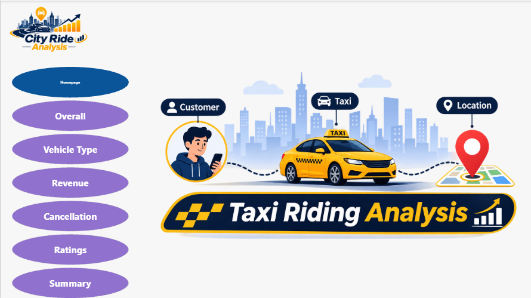

# 🚕 Taxi Riding Analysis Dashboard – Power BI

## 📌 Project Overview

This project presents an interactive Taxi Riding Analysis Dashboard using Microsoft Power BI. The objective is to analyze taxi ride booking data, identify business trends, and generate actionable insights to support data-driven decision-making.

## 🎯 Project Objectives

- Analyze taxi ride booking patterns.
- Monitor key business performance indicators.
- Identify trends in ride demand and booking performance.
- Present business insights through interactive visualizations.

## 🛠️ Tools & Technologies

- Microsoft Power BI
- Microsoft Excel
- Power Query
- DAX
- Data Visualization
- Data Modeling

## 📊 Dashboard Features

- Interactive KPI cards
- Booking trend analysis
- Business performance visualization
- Interactive filters and slicers
- Multi-page dashboard

## 📂 Project Files

- Power BI Dashboard (.pbix)
- Ride Booking Dataset
- Dashboard Screenshots
- Dashboard Design Assets
## 🏠 Home Dashboard

## 📊 Dashboard Preview

## 💡 Skills Demonstrated

- Data Cleaning
- Data Transformation
- Data Analysis
- Data Visualization
- Business Intelligence
- Dashboard Development

## 👨‍💻 Author

Abhishek Meena

Aspiring Data Analyst | Power BI | SQL | Python | Excel

GitHub: https://github.com/abhimeena01
